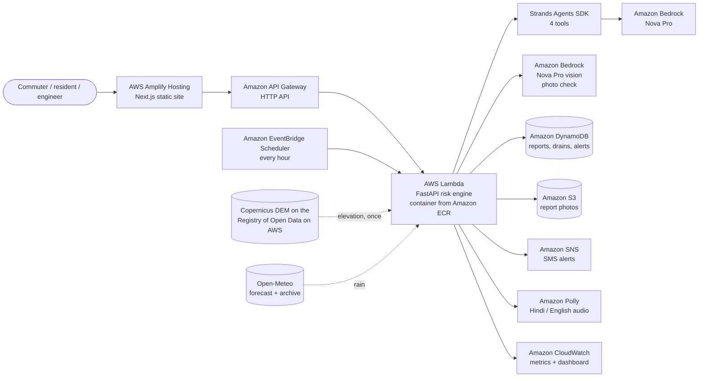

# FloodSense

**Know which roads will flood, hours before they do.**

FloodSense gives street-level flood warnings for Central Delhi. For every 150 m of road it
combines three things: the rain forecast, how low-lying that stretch is, and whether the drains
next to it are blocked right now. Then it tells two people exactly what to do:

- **The commuter**: *"Minto Bridge underpass likely floods by 08:10. Use Connaught Lane instead."*
- **The drain engineer**: *"Clean drain D-077 first. Baba Kharak Singh Marg goes from red to amber."*

Built for **Environmental Hacks** (WeMakeDevs x AWS, Bharat Builds Event 02), **Heat and Water** track.

| | |
|---|---|
| **Live app** | https://main.di7ky4nzu3ig3.amplifyapp.com |
| **Live API** | https://1v2v0c0ft9.execute-api.us-east-1.amazonaws.com/health |
| **Plan** | [docs/FloodSense_Plan.pdf](docs/FloodSense_Plan.pdf) |

## The problem

In a monsoon downpour a Delhi street can fill in an hour, and people find out when they are
already in the water. Rain alone does not predict it: 50 mm is fine on a high road with a clear
drain and floods a low road with a choked one. Nobody tells the commuter which road, or when, and
nobody tells the drain crew which drain matters most before tomorrow's rain.

## What it does

| Screen | For | What happens |
|---|---|---|
| **Flood map** (`/map`) | Commuters | 1,868 road segments coloured green, amber or red for the coming hours. Tap a road for the reason, the time it floods, and a road to use instead. Play the storm hour by hour. **Listen** reads the alert aloud (Hindi or English). |
| **Ask FloodSense** (on the map) | Commuters | An AI agent answers *"Will Minto Bridge flood?"* or *"क्या जनपथ पर पानी भरेगा?"* using the model's tools, and shows which tools it used. |
| **Report** (`/report`) | Residents | Photograph a blocked drain or waterlogged road. Amazon Bedrock checks the photo, rates severity, and the screen shows the consequence: *"your report changed Inner Circle from amber to red"*. |
| **Drain crew** (`/engineer`) | Engineers | A cleaning list ranked by how many roads stop flooding when that drain is cleared. One tap marks it cleaned and the map updates. Send the top warning as an **SMS alert**. |

Every red road has a plain-language reason. The whole app works in **Hindi and English**.

**Storm replay.** Judging happens outside the monsoon, so the app replays the real
**9 July 2026 Delhi storm** (125 mm between 03:00 and 09:00, from Open-Meteo's archive), clearly
labelled as a replay. Switch to **Live forecast** to score the next 6 hours of real weather.

**Demo crew sign-in.** The drain crew screen opens with a demo sign-in. Any badge and PIN work
(defaults `MCD-ENG-4092` / `482109`); it is there to show the role, not to secure anything.

## Architecture



### Where AWS fits

| Service | Its job in FloodSense |
|---|---|
| **Strands Agents SDK** (AWS open source) | The *Ask FloodSense* agent. Four tools: `rain_forecast`, `flood_risk`, `drain_priorities`, `draft_alert`. The agent answers only from these tools, and the app shows its trace. |
| **Amazon Bedrock (Nova Pro)** | Runs the agent, and checks every citizen photo: blocked drain, waterlogging, clear drain, or unrelated, with a severity. Unrelated photos never change the map. |
| **AWS Lambda + Amazon API Gateway** | The backend API (FastAPI in a container via Lambda Web Adapter), rate limited at the gateway. |
| **Amazon ECR** | Holds the backend container image. |
| **Amazon DynamoDB** | Drain status, citizen reports and the SMS alert log (one on-demand table). |
| **Amazon S3** | Report photos, private, served through short-lived links. |
| **Amazon SNS** | SMS flood alerts (sandbox, verified numbers). |
| **Amazon EventBridge Scheduler** | Rescores every road against the fresh forecast every hour. |
| **Amazon CloudWatch** | Custom metrics and a dashboard: reports checked by AI, SMS sent, agent questions, roads at risk from the hourly run. |
| **Amazon Polly** | Reads alerts aloud in Hindi or Indian English, for people who find reading hard. |
| **AWS Amplify Hosting** | The public web app. |
| **Registry of Open Data on AWS** | Copernicus GLO-30 elevation for every road segment. |

## How the risk model works

Each road is split into 150 m segments (1,868 in the study area). For every segment and every hour:

1. **Inflow**: rain × (base run-off + extra for low-lying spots). How low a segment is comes from
   the *sink depth* in the Copernicus 30 m elevation model; railway underpasses get a floor.
2. **Outflow**: what the drains within 80 m can carry, scaled by their state: clear 100%,
   not inspected 90%, partly blocked 55%, blocked 20%.
3. Water left over accumulates. It turns **amber** at 27 mm and **red** at 80 mm, which gives each
   road a timeline, a *floods by* time and a reason sentence.

A citizen photo of a blocked drain changes that drain's state, so nearby roads can turn red. The
engineer's list re-scores the area with each drain cleared in turn and ranks drains by how much
flooding that removes. The alternative road is the nearest named road that stays green.

### Does it work?

We checked the replayed storm against six places Delhi Traffic Police and PWD name as waterlogging
hotspots (locations taken from press reports, never used as model input):

- Roads within 150 m of a hotspot turned red **42%** of the time, against **12%** elsewhere:
  **3.6 times more often**.
- It is strong at Minto Bridge (80% of nearby segments red), Delhi Gate (65%) and Mandi House (60%),
  and weak at ITO (7%) and the Pragati Maidan tunnel (9%). Pumps and newer drainage there, which
  our data does not capture, may explain the gap; we have not confirmed it.

This is a sanity check on six points, not a validation study. The app says so on screen.

### Limitations

- Drain locations come from OpenStreetMap where mapped (11) and are otherwise **estimated** at road
  low points (932 of 943). Citizen reports are what make them real.
- 30 m elevation is coarse for a single underpass; the model adds a floor for underpasses.
- The model parameters were calibrated on one storm. More storms and real flood reports would tune them.
- SMS is in the SNS sandbox, so it only reaches verified numbers.

## Data sources

| Data | Source | Freshness |
|---|---|---|
| Rain | [Open-Meteo](https://open-meteo.com/) hourly forecast; historical-forecast archive for the replay | Live mode: refreshed every 15 min, rescored hourly |
| Elevation | [Copernicus DEM GLO-30](https://registry.opendata.aws/copernicus-dem/), Registry of Open Data on AWS | Static, clipped once |
| Roads, railways, mapped drains | © [OpenStreetMap](https://www.openstreetmap.org/copyright) contributors, via Overpass | Pulled once, Oct 2026 |
| Blocked drains | Citizen photo reports checked by Amazon Bedrock | Real time |
| Base map | OpenFreeMap (OpenStreetMap data) | Live tiles |

## Repo layout

| Path | What lives there |
|---|---|
| `backend/src/floodsense/` | `model.py` risk model · `agent.py` Strands agent · `vision.py` Bedrock photo check · `api.py` FastAPI · `store.py` local JSON or DynamoDB + S3 · `sms.py` SNS · `voice.py` Polly · `metrics.py` CloudWatch |
| `backend/scripts/` | Data pipeline: `fetch_osm.py`, `fetch_dem.py`, `build_segments.py`, `save_replay.py` |
| `backend/tests/` | API tests (pytest) |
| `data/processed/` | Road segments, drains, clipped elevation, storm replay |
| `frontend/` | Next.js (static export) + Tailwind + MapLibre |
| `Dockerfile` | Backend image for Lambda (Lambda Web Adapter) |
| `docs/` | Build plan |

## Run locally

Backend (Python 3.12 with [uv](https://docs.astral.sh/uv/)). The map, reports and drain list run
without an AWS account: state is kept in a local file, photo reports are accepted as "not checked
by AI", and SMS is not sent. The agent and audio need AWS credentials.

```bash
cd backend
uv sync
uv run uvicorn floodsense.api:app --app-dir src --port 8787
uv run pytest            # 6 tests
```

To use AWS locally, configure credentials (`aws configure`) and create `backend/.env`:

```bash
AWS_REGION=us-east-1
FLOODSENSE_USE_BEDROCK=1        # Nova photo checks and the agent
FLOODSENSE_USE_SNS=1            # real SMS
SNS_DEMO_PHONE=+91XXXXXXXXXX    # a number verified in the SNS sandbox
```

Frontend (Node 20+):

```bash
cd frontend
npm install
npm run dev                     # http://localhost:3000, talks to http://localhost:8787
```

Rebuild the data (optional, already committed):

```bash
cd backend
uv run python scripts/fetch_osm.py && uv run python scripts/fetch_dem.py
uv run python scripts/build_segments.py && uv run python scripts/save_replay.py
```

## Deploy

1. Build and push the backend image: `docker build --platform linux/amd64 -t <account>.dkr.ecr.us-east-1.amazonaws.com/floodsense-api:<tag> .` then `docker push`.
2. Lambda `floodsense-api` (container image, 2048 MB, 60 s) with `FLOODSENSE_TABLE`,
   `FLOODSENSE_BUCKET`, `FLOODSENSE_USE_BEDROCK=1`, `FLOODSENSE_USE_SNS=1`, `FLOODSENSE_METRICS=1`,
   behind an API Gateway HTTP API. The execution role allows Bedrock Nova, the one DynamoDB table,
   `uploads/*` in the bucket, SNS publish, Polly and CloudWatch metrics in the `FloodSense` namespace.
3. EventBridge Scheduler `rate(1 hour)` invokes the Lambda; Lambda Web Adapter passes the event to `POST /events`.
4. Frontend: `NEXT_PUBLIC_API_URL=<api url> npm run build`, then upload `frontend/out` to Amplify Hosting.

## Team

- **Devansh Goel** ([@DevanshG0el](https://github.com/DevanshG0el)): backend, risk model, AWS
- **Hiten** ([@Hiten0305l](https://github.com/Hiten0305l)): frontend, design, demo video

## AI tools used

As the rules require, we declare that **Claude Code** (Anthropic) was used throughout the
project: to research and plan, write and review backend and frontend code, set up and deploy
the AWS services, and draft this README. The team made the decisions, tested every flow and
reviewed the results.
